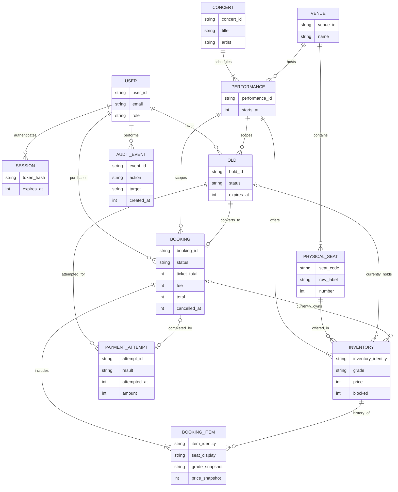

# 개념 데이터 모델

개념 ERD·업무 규칙·카디널리티를 정의한다. 단일 Node API·로컬 SQLite를 사용한다.

이 문서는 별도 model 저장 모델을 설명한다. 기본 legacy는 기존9개 테이블을 유지하며 model은 별도 DB_PATH/DB_SCHEMA로 명시 선택한다. 실제 저장 제약은 [논리 모델](logical.md)·[정규화](normalization.md)·[물리 모델](physical.md)을 따른다.

## 업무 범위와 용어

단일 호스트·단일 Node.js API 프로세스·로컬 SQLite에서 회원 인증, 공연·회차·좌석 관리, 선점, 데모 예매 확정, 전체 취소, 관리자 변경 이력을 다룬다. PostgreSQL·Redis·대체 외부 DB·캐시·메시지 브로커·다중 API 배포는 도입하지 않는다. 실제 PG 청구·환불·본인인증·실제 입장용 발권은 범위 밖이다.

| 용어 | 의미 |
| --- | --- |
| 회원 (USER) | 예매 주체. 관리자는 별도 사람이 아니라 관리자 역할을 가진 회원 |
| 세션 (SESSION) | 로그인 인증 상태. 한 회원이 여러 기기·탭에서 사용할 수 있음 |
| 공연 (CONCERT) | 제목·아티스트·소개 등 콘텐츠. 관람 일시를 가진 회차와 구분 |
| 회차 (PERFORMANCE) | 특정 공연을 특정 공연장에서 특정 시각에 진행하는 판매 단위 |
| 공연장 (VENUE) | 물리 좌석 배치가 속한 장소. 이름 문자열만으로 동일 장소임을 자동 단정하지 않음 |
| 물리 좌석 (PHYSICAL_SEAT) | 공연장의 열·번호·표시 코드로 식별하는 실제 위치. A-01 같은 코드는 공연장 안에서만 유일 |
| 회차별 좌석 재고 (INVENTORY) | 한 회차에서 한 물리 좌석을 판매하는 단위. 가격·등급·차단·현재 점유 관계를 가짐 |
| 선점 (HOLD) | 회원이 한 회차의 좌석 묶음을 제한 시간 동안 확보하는 행위와 상태 |
| 예매 (BOOKING) | 한 회원·한 회차의 데모 확정 거래와 취소 이력. 회원 정보와 별개로 예매자 정보를 보존 |
| 예매 항목 (BOOKING_ITEM) | 예매에 포함된 좌석 한 장과 확정 당시 등급·가격 스냅샷 |
| 데모 결제 시도 (PAYMENT_ATTEMPT) | 유효한 회원·선점에 연결된 데모 확정 시도의 결과. 실제 금전 이동을 뜻하지 않음 |
| 감사 기록 (AUDIT_EVENT) | 관리자 좌석 차단·해제·공연 등록 등의 행위자·대상·시각 기록 |
| 입장권 | 회차 대기열의 API 접근 권한. 예매 항목이나 실제 입장용 티켓과 구분 |

회원·공연·회차·장소·좌석·선점·예매·결제 시도·감사 기록은 영속 데이터다. 대기열·입장권·제한 카운터는 단일 프로세스의 메모리 상태이며 ERD에 큐 테이블을 추가하지 않는다. 재시작 때 DB 유효 선점/예매는 보존하고 일반 큐는 재진입한다. 보호 API와 복구 정책은 [API 명세](../design/api.md)를 따른다.

## 엔터티와 주요 속성

속성은 업무상 필요한 정보의 개념이며 실제 컬럼명·타입·저장 여부를 확정하지 않는다. 그림의 string/int는 읽기 편의를 위한 표기다. 금액은 원 단위 정수, 저장 시각은 UTC epoch milliseconds, 화면 표시는 Asia/Seoul 원칙을 이어간다.

| 엔터티 | 식별 개념 | 주요 정보·생명주기 |
| --- | --- | --- |
| USER | 회원 ID, 정규화된 이메일 | 이름·전화번호·비밀번호 해시·역할·가입 시각. 이력을 참조하는 회원을 예매와 함께 삭제하지 않음 |
| SESSION | 세션 토큰 해시 | 회원·CSRF 값·만료 시각. 원문 인증 토큰은 DB에 저장하지 않으며 로그아웃·만료로 제거 가능 |
| CONCERT | 공연 ID | 제목·아티스트·소개·테마·관람 시간·관람 등급. 장소는 회차를 통해 결정 |
| VENUE | 공연장 ID | 명칭·표시용 지역. 초기에는 기존 장소 문자열을 보존하며 실제 동일 장소의 통합은 검토 후 결정 |
| PHYSICAL_SEAT | 공연장과 좌석 코드 | 열·번호·표시 코드. 판매 가격이나 점유 상태를 갖지 않음 |
| PERFORMANCE | 회차 ID | 공연·공연장·시작 시각. 재고가 생성된 뒤 장소를 바꿔 기존 좌석 연결을 무효화하지 않음 |
| INVENTORY | 회차와 물리 좌석 | 등급·원 단위 가격·판매 차단 여부·현재 선점 또는 현재 예매. 회차 안에서 같은 좌석은 한 번만 존재 |
| HOLD | 선점 ID | 회원·회차·만료 시각·상태. 선택 변경 시 ID 교체와 기존 만료 시각 유지 |
| BOOKING | 예매 ID와 원본 선점 | 회원·회차·확정/취소 상태·티켓 합계·수수료·총액·예매자 이름/전화·수령 방식·생성/취소 시각 |
| BOOKING_ITEM | 예매와 좌석 재고 | 불변 좌석 코드 연결·확정 당시 등급·가격. 취소 후에도 보존하며 재고의 새 가격으로 덮어쓰지 않음 |
| PAYMENT_ATTEMPT | 데모 시도 ID | 선점·결과·시도 시각·서버 계산 금액(계산 가능 시)·성공한 예매 연결. 키·본문 해시·실패 분류·세부 상태는 후속 설계 |
| AUDIT_EVENT | 감사 기록 ID | 관리자 회원·동작·대상 식별 정보·상세·발생 시각. 비밀번호·토큰·불필요한 개인정보는 기록하지 않음 |

## 개념 ERD

`||`는 정확히 1, `o|`/`|o`는 0 또는 1, `o{`는 0 이상, `|{`는 1 이상이다. 최대 4개, 상태별 참여 조건, 회차·공연장 일치 같은 제약은 뒤의 표와 업무 규칙으로 보완한다. 선점과 예매에서 재고로 향하는 current 관계는 **현재 점유**이며 영구적인 구매 이력은 BOOKING_ITEM으로 나타낸다.

## 관계의 카디널리티와 선택성

| 관계 | 한쪽에서 본 참여 수 | 반대쪽의 필수성·추가 제약 |
| --- | --- | --- |
| USER → SESSION | 회원당 0..N 세션 | 세션은 정확히 1명에 속함. 로그아웃해도 회원은 남음 |
| CONCERT → PERFORMANCE | 공연당 1..N 회차 | 회차는 정확히 1개 공연. 현재처럼 공연 등록과 회차 생성을 함께 완료하며 임시 초안 공연은 이번 모델에서 다루지 않음 |
| VENUE → PERFORMANCE | 공연장당 0..N 회차 | 회차는 정확히 1개 공연장에서 진행 |
| VENUE → PHYSICAL_SEAT | 공연장당 0..N 좌석 | 물리 좌석은 정확히 1개 공연장. 판매 회차 등록에는 좌석이 있어야 함 |
| PERFORMANCE → INVENTORY | 회차당 1..N 재고 | 재고는 정확히 1개 회차. 현재 생성 규칙은 96개 |
| PHYSICAL_SEAT → INVENTORY | 물리 좌석당 0..N 재고 | 재고는 정확히 1개 물리 좌석. 서로 다른 회차에서 같은 위치를 판매할 수 있음 |
| USER → HOLD | 회원당 이력 포함 0..N 선점 | 선점은 정확히 1명. 회원·회차별 유효한 active 선점은 최대 1개 |
| PERFORMANCE → HOLD | 회차당 0..N 선점 | 선점은 정확히 1개 회차 |
| HOLD → INVENTORY (current) | 선점당 0..4개 재고 | 재고의 현재 선점은 0..1개. 유효한 active는 1..4개, released/expired/converted는 0개 |
| USER → BOOKING | 회원당 이력 포함 0..N 예매 | 예매는 정확히 1명 소유. 예매자 이름이 소유 회원과 달라도 권한은 소유 회원 기준 |
| PERFORMANCE → BOOKING | 회차당 0..N 예매 | 예매는 정확히 1개 회차. 다른 회차 항목 혼합 금지 |
| HOLD → BOOKING | 선점당 0..1 예매 | 예매는 정확히 1개 원본 선점. 취소해도 같은 선점으로 새 예매를 생성하지 않음 |
| BOOKING → BOOKING_ITEM | 예매당 1..4 항목 | 항목은 정확히 1개 예매. 한 예매에서 같은 재고 중복 금지 |
| INVENTORY → BOOKING_ITEM (history) | 재고당 이력 포함 0..N 항목 | 항목은 정확히 1개 재고. 취소 후 다른 예매의 항목으로 다시 등장 가능 |
| BOOKING → INVENTORY (current) | 예매당 0..4 재고 | 재고의 현재 예매는 0..1개. confirmed는 본인 항목 1..4개를 점유하고 cancelled는 0개 |
| HOLD → PAYMENT_ATTEMPT | 선점당 0..N 데모 시도 | 시도는 정확히 1개 선점에 속함. 회원·회차는 선점으로 결정; 타인 선점·존재하지 않는 선점 요청은 이 관계를 만들지 않음 |
| BOOKING ↔ PAYMENT_ATTEMPT | 양쪽 모두 0..1 연결 | 새 예매에는 성공 시도 1개, 성공 시도에는 예매 1개. 실패 시도는 예매 없음. 기존 예매는 결제 시도 기록 부재로 연결이 없을 수 있음 |
| USER → AUDIT_EVENT | 회원당 0..N 기록 | 현재 범위의 감사 기록은 정확히 1명의 관리자 행위자. 대상은 동작별 공연·회차/좌석 식별 정보이며 상세 FK 설계는 후속 |

0..N 이력과 현재 점유 0..1을 혼동하지 않는다. 재고를 동시에 선점과 확정 예매가 점유할 수 없고 차단 재고는 어느 쪽도 점유할 수 없다. active 상태가 DB에 남아 있어도 `expires_at <= server_now`이면 유효 선점이 아니며 변경 트랜잭션에서 만료를 정리한다.

## 업무 규칙과 구현 대조

| ID | 유지하거나 구현할 규칙 | 현재 근거·후속 검증 |
| --- | --- | --- |
| BR-01 | 회차·재고·선점·예매·예매 항목의 회차가 일치하고, 재고의 물리 좌석은 해당 회차 공연장에 속한다 | 현재 물리 좌석/공연장 분리 없음. 논리 모델에서 복합 키/FK 및 필요한 트랜잭션 검증 설계 |
| BR-02 | 한 재고의 현재 점유자는 선점 1개 또는 예매 1개이며, blocked이면 점유 없음 | 현재 seats CHECK와 setHold/checkout/blockSeats. 목표 모델에서도 DB 제약과 요청 검증을 함께 사용 |
| BR-03 | 최초 유효 선점은 서버 기준 7분. 선택 변경은 새 hold ID를 발급하되 기존 만료 시각을 유지하고 이전 ID는 released 처리 | setHold 및 만료·다른 탭 테스트. 빈 선택은 해제이며 새 선점의 기준 시각은 별도 새 선택에서 시작 |
| BR-04 | 회원·회차별 확정 항목 수 + 유효 선점 좌석 수는 최대 4. 선택·확정 시 같은 짧은 트랜잭션에서 확인 | 현재 setHold만 수량 검사. checkout 재검사와 실제 동시성 검증은 계획 3에서 보강 |
| BR-05 | 다중 좌석 검증·변경·선점 만료·확정·전체 취소는 전부 성공하거나 전부 롤백 | 현재 BEGIN IMMEDIATE·expire·묶음 롤백 테스트. 조건부 갱신 행 수 확인은 후속 |
| BR-06 | 새 선점·새 확정·최초 취소·좌석 차단 변경은 공연 시작 전만 허용. 유효 선점도 공연 시작을 넘겨 새 확정을 허용하지 않음 | openPerformance와 공연 마감 테스트. 완료된 확정/취소의 재시도는 기존 결과 반환 |
| BR-07 | 금액은 서버 계산. ticket_total = 항목 가격 합계, fee = 항목 수 × 2,000원, total = ticket_total + fee | checkout·가격 조작 테스트. 확정 당시 등급·가격·합계·수수료 보존. 총액·스냅샷 무결성 제약은 논리/물리 설계에서 구체화 |
| BR-08 | 동일 선점은 최대 1개 예매로 확정. 완료 요청 재시도는 기존 결과를 반환하며 취소된 예매를 되살리지 않음 | hold_id UNIQUE·checkout과 다른 탭 테스트. 일반 멱등성 키·본문 충돌·보존 기간은 후속 API 설계 |
| BR-09 | 취소는 예매 전체와 수수료를 포함한 전액 데모 취소. cancelled_at과 모든 항목·금액은 남기고 현재 재고 점유만 해제 | cancel·반복 취소·재판매 테스트. 부분 취소·외부 환불 기록은 이번 범위 밖 |
| BR-10 | 예매 항목 전체 이력에 회차·좌석 UNIQUE를 걸지 않음. 한 예매 안의 재고 중복과 현재 중복 판매만 금지 | 현재 booking_seats의 예매·좌석 PK와 seats.booking_id. 취소 후 재판매 사례로 논리/DDL 검증 |
| BR-11 | 예매·선점의 회원은 같고 데모 성공 시도의 선점도 예매 원본 선점과 같아야 함. 신규 성공 시도·예매·항목·재고 전환을 원자적으로 완료 | 현재 예매 소유권 검사 존재, 별도 결제 시도 없음. 실패 시도 기록은 예매 롤백과 분리된 안전한 기록 정책을 후속 설계하며 DB 오류 기록 성공을 보장하지 않음 |
| BR-12 | 판매·이력 연결이 있는 회차·물리 좌석의 식별/장소를 바꾸거나 연결된 이력을 연쇄 삭제하지 않음 | 현재 관련 수정/삭제 API 없음. 마이그레이션은 ID·가격·취소 상태를 보존. 금액·시간·토큰 정보를 임의 생성하지 않음 |
| BR-13 | 관리자 권한으로 공연 생성·차단/해제하며 선점/확정 좌석은 차단하지 않음. 감사 기록은 해당 변경과 함께 저장 | requireAdmin·createConcert·blockSeats 및 테스트. 시스템 행위자와 범용 감사 대상 FK는 후속 필요 시 별도 설계 |
| BR-14 | SQLite가 판매 가능 여부의 최종 원본. 큐 입장과 화면 캐시가 좌석 확보를 보장하지 않음 | 현재 Store가 원본, 큐 미구현. 단일 writer·동기 DB의 한계를 후속 실험에서 측정 |

## 현재 테이블에서 목표 개념으로의 대응

| 현재 구현 | 목표 개념 | 보존·호환 시 고려 사항 |
| --- | --- | --- |
| users / sessions | USER / SESSION | 회원 ID·비밀번호 해시·세션을 보존. 세션과 큐 입장권은 서로 다른 개념 |
| concerts | CONCERT + VENUE 후보 | 공연 ID·속성 유지. 기존 venue 문자열을 잃지 않고 회차의 장소로 대응. 동일 문자열만 보고 다른 공연의 좌석을 자동 병합하지 않음 |
| performances | PERFORMANCE | 회차 ID·공연·시작 시각 유지, 회차별 공연장 연결 추가 |
| seats | PHYSICAL_SEAT + INVENTORY | `(performance_id,id)` 기존 좌석 식별과 코드 유지. 같은 공연장임을 확인한 좌석만 공유 물리 좌석에 대응. 현재 API의 A-01 등 seatIds는 내부 ID와 분리해 호환 |
| holds | HOLD | 기존 상태·소유자·회차·만료 시각 보존. 현재 재고 연결이 사라진 released/expired 선점의 과거 좌석 목록은 복원할 수 없으며 만들지 않음 |
| bookings | BOOKING | 예매 ID·원본 hold·상태·총액·수수료·예매자·시각 유지. 과거 예매의 결제 시도 연결은 선택적 |
| booking_seats | BOOKING_ITEM | 기존 예매·좌석 코드·등급·가격 스냅샷 유지. 회차는 예매를 통해 식별, 대응 재고를 검증한 뒤 연결. 확정 당시 좌석 표시는 기존 코드로 보존 |
| 별도 테이블 없음 | PAYMENT_ATTEMPT | 새 데모 확정부터 기록할 목표 개념. 과거 성공/실패 시도 시각·요청 키·실패 내역을 추측해 생성하지 않음 |
| audit | AUDIT_EVENT | 관리자 회원·동작·상세·시각 유지. 기존 detail은 없애지 않고 후속 대상 구조와 대응 |

목표 모델은 공연마다 모든 회차가 같은 장소라는 제약을 두지 않는다. 기존 UI가 concerts.venue 하나와 첫 회차 가격을 사용하므로, 기존 등록 API에서는 입력 장소를 모든 신규 회차에 동일하게 연결하고 기존 화면 표현을 유지하는 방안을 후속 API 설계에서 정한다. 회차별 다른 장소·가격을 노출하는 UI 변경은 이 문서 작성만으로 구현한 것이 아니다.

현재 생성 좌석은 A~H열 × 12석이며 VIP 24석 / R 36석 / S 36석이다. 현재 가격은 S 기본가, R +20,000원, VIP +40,000원이다. 이 규칙은 회차 재고 생성 규칙으로 두며 물리 좌석의 고정 가격이나 공연장 전체의 영구 등급으로 옮기지 않는다.

## 모델로 확인한 사례와 후속 범위

| 사례 | 모델상 기대 결과 |
| --- | --- |
| 같은 공연장 A-01을 금요일·토요일 회차에서 판매 | 물리 좌석은 공유 가능하지만 재고는 회차별 2개. 서로의 선점·예매에 영향 없음 |
| 다른 공연장에도 A-01 존재 | 물리 좌석과 재고는 서로 별개. 좌석 코드만으로 연결하지 않음 |
| 확정 3매인 회원이 같은 회차에서 2석 선택 | BR-04에 따라 전체 거부. 한 석만 임의 성공시키지 않음 |
| 선택 1분 뒤 다른 좌석으로 교체 | 새 hold ID, 최초 만료 시각 유지. 이전 ID 주문은 거부 |
| 공연 시작 시각에 도달한 유효 hold로 신규 확정 | BR-06에 따라 거부. 이미 완료된 예매 재시도만 기존 결과 반환 |
| 예매 A 취소 후 같은 재고를 예매 B로 재판매 | 이력 항목은 A·B 두 개, 현재 재고 소유는 B 하나. A는 취소 상태로 보존 |
| 같은 hold의 확정 응답 유실 후 재시도 | 예매와 성공 결제 시도 재사용. 추가 성공 시도나 신규 예매를 만들지 않음 |
| 기존 예매를 데이터 보존 마이그레이션 | 항목·금액·소유권·취소 상태 보존. 결제 시도 연결 0개 허용, 가짜 과거 시도 생성 금지 |

위 사례는 업무 규칙의 설계 설명이다. 실제 예매·대기열·권한 계약은 [API 명세](../design/api.md)를 따른다.

논리 모델은 현재 점유를 두 연결 릴레이션으로 분리해 12개 엔터티를 14개 릴레이션으로 구체화한다. 그림의 seat_display는 이력이 참조하는 불변 물리 좌석 코드에서 구하는 파생 표시다. ticket_total과 total도 보존된 항목 가격·수수료에서 구하는 파생 값이며, 현재 API는 기존 공개 ID/JSON을 유지하며 model의 보존된 항목/수수료에서 금액을 계산한다.

ModelStore의 현재 점유·이력·성공 시도 일치는 FK만으로 해결되지 않는다. X-01~X-09·트리거·짧은 트랜잭션을 함께 적용한다.
