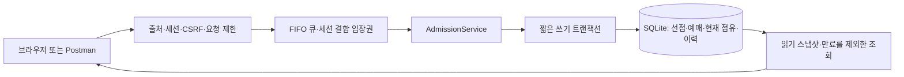

# ticket-ssu 서비스 문제·개선 분석

기준일: 2026-11-03. 현재 로컬 작업트리의 model 모드를 기준으로 한다. 회원 탈퇴·프로젝트명 변경 등 미커밋 변경이 포함되어 있으므로 원격 main과 같다고 가정하지 않는다. 이 문서는 과제 설명과 코드 근거를 보관하고, 담당·진행 상태·팀 결정은 Notion 문제·개선 보드에서 관리한다. 과거 작업 계획이나 개별 테스트 실행 로그를 문서로 계속 쌓지 않는다.

## 1. 프로젝트의 중심 질문

목표는 예매 화면을 만드는 데서 끝나지 않고, 제한된 자원을 여러 사용자가 동시에 요청할 때 정확성과 응답성을 어떻게 지키는지 설명하는 것이다. 발표는 **실패 시나리오 → 원인 → 선택한 방법 → 구현 → 실험 → 비용과 남은 한계 → 팀 결정** 순서로 전개한다.

아래 실패 시나리오는 코드로 재현할 문제 모델이다. 과거 운영에서 실제 장애가 발생했다거나, 모든 개선을 단계별로 측정했다는 뜻은 아니다. 당시 구현과 실행 자료가 없는 경우에는 가상 비교 조건 또는 현재 구현의 검증으로 명확히 표시한다.

| 논점 | 서비스에서 발생할 문제 | 현재 구현에서 확인한 대응 | 아직 주장할 수 없는 것 |
| --- | --- | --- | --- |
| 동시성 | 같은 좌석의 중복 판매, 묶음 좌석 일부만 변경 | 트랜잭션·점유 PK·영향 행 수 검사·롤백 | 여러 API 서버로 확장해도 같은 동작이라는 주장 |
| 상태 정합성 | 만료된 선점 결제, 취소 후 좌석 미복구, 4매 초과 | 서버 시각 재검증·상태 전이·현재 점유와 이력 분리 | 화면 표시가 언제나 최신이라는 주장 |
| 반복 요청 | 응답 유실 후 재결제로 중복 예매 | hold 단위 UNIQUE, model 선택 멱등성 키 | 실제 PG가 포함된 정확히 한 번 결제 |
| 트래픽 | 폴링이 쓰기 잠금을 만들고 변경 요청을 지연 | 읽기 스냅샷·주기 만료·클라이언트 백오프 | 이번 소규모 실험으로 최대 수용 인원 산정 |
| 과부하 | 새로고침·우회 API 호출·무한 대기로 자원 고갈 | FIFO 입장권·정원/입장률 분리·요청 제한·상한 | 봇·DDoS 완전 차단 또는 구매 공정성 완성 |
| 장애 | 재시작으로 큐·메모리 상태 소실 | DB 선점 복구·복구 전용 입장·상태 확인·정상 종료 | 대기 순번 영속화, 무중단 서비스 |
| 계정 | 탈퇴 후 다른 기기의 접근·선점 잔존 | 모든 세션/선점/큐 제거·회원/예매자 비식별화 | DB 파일·WAL·백업의 물리적 개인정보 삭제 |

## 2. 구조와 보장의 경계



큐는 들어갈 순서를 제어하고 SQLite는 실제 판매를 결정한다. 입장권을 갖고 있어도 DB에서 좌석·소유권·시각·매수를 다시 검사한다. 화면과 큐를 판매 원본으로 사용하지 않는다.

현재 구조는 한 호스트·한 Node API·로컬 SQLite다. WAL은 읽기와 쓰기의 공존을 돕지만 동시에 여러 writer를 실행시키지는 않는다. [SQLite WAL 설명](https://www.sqlite.org/wal.html#concurrency)

코드의 DatabaseSync 호출은 동기 실행이다. DB 구간이 길어지면 같은 Node 이벤트 루프의 다른 요청도 영향을 받는다. JavaScript가 한 스레드라는 사실만으로, await 사이의 인증 변경이나 외부 DB writer까지 안전해지는 것은 아니다. [Node SQLite 설명](https://nodejs.org/api/sqlite.html)

## 3. 문제별 구현·장단점

### C-01. 같은 좌석을 동시에 구매한다

예: 두 회원이 A-01/A-02를 동시에 선점한다. 조회에서 둘 다 available을 봤더라도 확정 권리는 한 회원에게만 있어야 한다. A-01 처리 후 A-02에서 충돌하면 일부만 선점해서도 안 된다.

- 구현: [ModelStore](../../lib/model-store.mjs)의 setHold/checkout/cancel이 BEGIN IMMEDIATE 안에서 다시 검사한다. current_holds와 current_bookings는 재고 ID를 PK로 사용하고, 트리거가 양쪽 동시 점유를 거부한다. 변경 행 수와 최종 개수도 확인한다.
- 검증: [동시성 테스트](../../tests/concurrency.test.mjs)는 두 세션의 묶음 경합에서 200/409 한 쌍과 패자의 기존 선점 보존을 검사한다. 취소·재판매 경합 및 외부 writer 잠금도 다룬다.
- 장점: 판매 권리와 묶음 변경을 한 DB 거래로 설명할 수 있다. 앱 검사 실수에 대해 DB 제약도 방어한다.
- 비용: writer는 직렬화된다. 경쟁이 늘면 대기 또는 503이 늘 수 있으며 긴 트랜잭션은 전체 응답성을 해친다.
- 대안 비교: 메모리 mutex는 현재 프로세스 안에서는 단순하지만 외부 writer나 다중 프로세스를 보호하지 못한다. 조건부 UPDATE와 영향 행 수 검사는 유용하지만 묶음 변경의 원자성을 위해 여전히 트랜잭션이 필요하다. 행 잠금이 있는 외부 DB로 바꾸는 것은 별도 구조 변경·운영 비용을 평가할 사안이다.
- 팀 질문: 충돌 실패 409를 어떻게 표시하고 좌석을 다시 고르게 할 것인가? 어떤 부하에서 지연을 더 이상 허용하지 않을 것인가?

### S-01. 선점·만료·취소·이력이 어긋난다

예: 결제 직전에 선점이 만료되거나, 취소한 좌석을 다른 사용자가 다시 사면서 과거 항목이 덮어써진다.

- 구현: 선점 7분·공연 시작·회원당 확정+선점 4매를 서버에서 검사한다. holds의 active/released/expired/converted와 bookings의 confirmed/cancelled를 구분한다. 현재 점유 연결과 booking_items·payment_attempts 이력을 분리한다. 물리 만료 정리가 늦어도 조회와 쓰기 검증은 만료된 점유를 인정하지 않는다.
- 검증: [예매 정책](../../tests/booking-policy.test.mjs)은 정확한 만료 경계·공연 시작 경계·4매 합산을, [모델 Store](../../tests/model-store.test.mjs)는 항목 삽입/취소 중간 오류의 전체 롤백을 검사한다. [물리 제약](../../db/migrations/001_guards.sql)도 참조한다.
- 장점: 취소 후 재판매해도 원래 가격·항목·결제 이력을 유지한다. 5초 정리 타이머와 정확성 보장을 분리한다.
- 비용: 테이블·JOIN·트리거와 변경 순서가 복잡하다. 앱 검사와 DB 제약이 중복되어 명세·테스트를 함께 유지해야 한다.
- 대안 비교: seats의 상태 컬럼만 바꾸면 읽기는 단순하지만 판매 이력과 현재 점유가 섞인다. 모든 상태를 이벤트로만 저장하면 추적은 쉬워질 수 있지만 재구성과 운영 복잡도가 커진다. 현재 과제는 현재 점유+보존 이력을 선택했다.
- 팀 질문: 화면에 남아 있는 오래된 선택과 서버 거부를 어떻게 설명할 것인가? 상태 전이 표와 실패 주입 테스트를 누가 검토할 것인가?

### I-01. 응답 유실로 결제를 다시 누른다

예: 첫 요청은 커밋되었지만 응답을 받지 못해 같은 요청을 다시 보낸다.

- 구현: 같은 hold_id의 예매는 하나이며 완료한 결과를 재반환한다. model에서는 선택 Idempotency-Key와 정규화한 본문 해시를 기록한다. 같은 키/다른 본문은 409다. 취소한 결과를 재요청해도 confirmed로 되살리지 않는다.
- 검증: [동시성 테스트](../../tests/concurrency.test.mjs)의 동일 확정 8회 요청은 모두 같은 예매 ID로 귀결된다. model-store 테스트는 성공 시도 1개·취소 후 재반환을 확인한다.
- 장점: 사용자 재시도와 네트워크 응답 유실에 대응한다. 성공 결제 시도와 판매 변경을 같은 DB 트랜잭션에 기록한다.
- 비용: 키·본문 해시·실패 결과 보존 규칙이 필요하다. 같은 키의 영속 업무 실패를 반복해도 자동 재실행되지 않는다. 현재 브라우저는 선택 키를 보내지 않고 hold 단위 호환 경로를 사용한다.
- 미구현: 실제 PG 요청/웹훅/환불, 외부 결제와 DB 사이의 불일치 복구. 새 hold로 다시 결제하는 것까지 전역 중복 결제 방지로 묶어 주장하지 않는다.
- 팀 질문: 브라우저에서도 키를 사용할 것인가? 실제 PG는 과제 범위 밖으로 명시할 것인가?

### T-01. 좌석 폴링이 쓰기 부하를 만든다

예: 화면을 새로 읽을 때마다 선점 만료 UPDATE를 실행하면, 보기만 하는 사용자도 writer 경쟁에 참여한다.

- 구현: [ModelStore](../../lib/model-store.mjs)의 seatMap/concerts/adminSummary는 BEGIN+SELECT 스냅샷으로 읽고 시각 조건으로 만료를 제외한다. 서버의 5초 만료 정리와 실제 변경 트랜잭션에서 물리 정리를 수행한다. 큐 상태 자체는 메모리에서 읽되 인증 세션 조회는 남는다.
- 클라이언트: [pollDelay](../../public/polling.mjs)는 기본 약 3초·jitter·최대 30초 오류 백오프를 사용하며, 더 긴 Retry-After를 존중한다. [브라우저](../../public/app.js)는 응답 뒤 다음 조회를 예약하고 숨긴 탭의 HTTP 폴링을 건너뛴다.
- 검증: [트래픽 테스트](../../tests/traffic.test.mjs)는 읽기 중 DML 미발생·만료 제외·외부 writer 잠금 중 읽기·다음 스냅샷에서 새 커밋 반영을 검사한다. 아래 실험은 읽기당 쓰기를 제거한 구조 효과를 측정한다.
- 장점: 읽기가 writer가 되는 원인을 제거한다. 조회 시 즉시 만료를 반영하면서 타이머 정리 지연을 허용한다.
- 비용: 짧은 시간 화면이 최신 상태와 다를 수 있고, 읽기 빈도 자체는 사용자 수에 비례한다. 초당 쓰기가 줄었다고 쿼리 비용이 사라지는 것은 아니다.
- 대안 비교: 캐시는 응답 비용을 줄일 수 있지만 좌석 표시의 만료·무효화가 필요하고 판매 판단을 대신할 수 없다. Push/SSE는 반복 조회를 줄일 수 있지만 연결·복구 비용과 현재 시연 경로의 지원 여부를 별도로 검증해야 한다. 이번 변경에서 추가하지 않았다.
- 팀 질문: 폴링 주기를 늘리면 부하는 줄어도 좌석 상태 반영 지연이 커진다. 허용 지연을 먼저 합의할 것인가?

### T-02. 대기열 우회·공유 IP 제한·과부하

- 구현: [PerformanceQueue](../../lib/performance-queue.mjs)는 회차별 FIFO·중복 진입 유지·세션 결합 토큰을 사용한다. 기본 활성 정원 50명과 최근 1초 입장 5명은 서로 다른 제한이다. 큐·회차 버킷의 메모리 상한도 둔다. 비어 있지 않은 선점과 신규 확정은 DB 거래 안에서 입장권을 검사한다.
- 요청 제한: [RequestLimiter](../../lib/request-limiter.mjs)는 IP/회원 token bucket과 인증 횟수 창을 사용한다. 기본 IP burst 120·초당 보충 30, 회원 burst 60·초당 보충 15, 인증 합산 10분 30회다. 이 값은 수용량 측정 결과나 SLA가 아니다.
- 장점: UI를 건너뛴 직접 요청도 입장권을 검사하고 큐의 무한 증가를 제한한다. 429/503의 Retry-After로 재시도 폭주를 완화한다.
- 비용: 입장 50명은 동시 HTTP 요청 50개라는 뜻이 아니다. 대기열 자체의 인증/폴링 요청은 남는다. 숨긴 탭의 대기 항목은 유휴 기한 뒤 사라져 다시 줄을 설 수 있다.
- 현재 시연의 제약: [Quick Tunnel](../../lib/quick-tunnel.mjs)은 검증되지 않은 외부 IP 헤더를 버린다. 따라서 모든 터널 이용자가 loopback IP 예산을 공유해 다른 사용자의 로그인에도 영향을 줄 수 있다. 한 번의 429를 서버 용량 부족이라고 단정해서는 안 된다.
- 팀 질문: 실제 팀 시연에서 공유 IP 예산을 어떻게 안내할 것인가? 신뢰된 프록시의 사용자 IP 검증을 추가하기 전까지 제한값 변경 실험을 어떻게 격리할 것인가?

### R-01. DB 잠금과 프로세스 재시작

- 구현: [DB 재시도](../../lib/db-retry.mjs)는 native busy_timeout 25ms, 최대 4회, 20/40/80ms+0~9ms jitter로 제한한다. 동기 DB 거래가 종료/롤백된 뒤에만 await하며 매 시도에 세션·시각·입장권을 재검증한다. 소진 시 503/Retry-After: 1이다. 350ms는 재시도 중단 판단 기준이며 HTTP 완료 시간의 하드 상한이 아니다.
- 복구: DB 선점은 재시작 후 먼저 큐 정원에 반영하고 본인의 기존 hold만 확정/해제하는 복구 입장권을 준다. 정상 종료는 새 요청 수신을 중단하고 유예 시간 뒤 연결과 DB를 정리한다. health와 readiness를 구분한다.
- 검증: [동시성](../../tests/concurrency.test.mjs)은 외부 writer로 잠금을 만든 뒤 읽기 진행·제한 재시도·세션/만료 재검증을 확인한다. [입장권](../../tests/admission.test.mjs)은 재시작 복구와 부족한 정원 설정의 시작 거부를 확인한다. [종료](../../tests/deployment.test.mjs)·[백업/복구](../../tests/operations.test.mjs)도 구현되어 있다.
- 장점: 한 요청이 무한히 자원을 잡지 않으며, 재시작을 선점 시간 연장이나 매수 제한 우회 수단으로 쓰기 어렵다.
- 한계: 대기 순번·일반 입장권·요청 제한 예산은 메모리이므로 재시작 시 소실된다. 고가용성, 자동 장애 조치, 무중단 배포, 정기 백업 운영은 완성되지 않았다.
- 팀 질문: 대기 순번 소실을 데모의 명시적 한계로 수용할 것인가? 영속 큐나 외부 DB의 비용을 들일 만큼 현재 과제에서 요구하는가?

### A-01. 탈퇴와 다른 기기의 진행 중 요청

- 구현: [회원 탈퇴](../../lib/store.mjs)는 비밀번호를 재확인하고, 한 DB 거래에서 시작 전 확정 예매 검사·전체 선점/세션 해제·회원/예매자 비식별화를 수행한다. 커밋 뒤 전체 본인 큐를 제거한다. 로그인 암호 확인이 await 중이었어도 새 세션 생성 시 탈퇴 상태를 재확인한다.
- 검증: [탈퇴 테스트](../../tests/withdrawal.test.mjs)는 다른 기기 세션 무효화·DB 오류 전체 롤백·재가입의 새 ID·비동기 로그인 경합을 검사한다.
- 장점: 로그아웃과 탈퇴의 의미를 구분하고 판매 이력과 개인정보 처리를 분리한다.
- 한계: 현재 탈퇴 상태는 스키마와 호환되는 예약 해시로 표현한다. 상태 컬럼·탈퇴 시각을 별도 두는 방식보다 명시성이 낮다. SQLite 과거 페이지·WAL·백업까지 지워지는 물리 삭제가 아니다. 실제 개인정보 처리 정책과 백업 보관 정책은 별도 설계가 필요하다.
- 팀 질문: 정합성 사례의 확장 주제로 발표할 것인가? 스키마 개정까지 진행할 것인가?

## 4. 이번에 수행한 읽기 트래픽 비교 실험

실험일: 2026-11-03. Node v26.13.0, Windows x64, 8 논리 CPU, 약 16GB RAM. 같은 PC에서 별도 k6 프로세스와 단일 API, 새 model DB를 각각 실행했다. 기존 회원/예매 DB와 외부 터널은 사용하지 않았다.

각 조건 약 20초, 가상 사용자 0→2→8→16→0, 사용자별 sleep 0.25초의 좌석 조회다. IP 제한은 비교를 위해 burst 240·초당 보충 120으로 동일하게 올렸으며 일반 실행 기본값과 다르다. 실제 관측된 최대 진행 중 HTTP 요청 수는 두 조건 모두 1이었다. 이 실험은 쓰기 발생 원인을 비교하며 포화 부하나 판매 경쟁의 검증은 아니다.

비교 조건 read-control은 현재 seatMap 앞에 transaction+expire를 삽입한 실험용 조건이다. 과거 커밋이나 실제 장애 당시 구현을 복원한 것은 아니다. read-current는 현재 구현 그대로다. 구현 위치는 [부하 fixture](../../load-tests/load-fixture.mjs), [k6 요청](../../load-tests/k6-scenarios.js), [계측/판정](../../load-tests/k6-runner.mjs)이다.

| 지표 | read-control: 읽기마다 만료 쓰기 | read-current: 현재 읽기 | 해석 |
| --- | --- | --- | --- |
| HTTP 요청 / 200 응답 | 528 / 528 | 528 / 528 | 동일 요청 수, 예상 밖 응답 0 |
| BEGIN IMMEDIATE 수 | 532 | 4 | 읽기 528회가 만든 쓰기 거래 제거; 두 조건 모두 타이머 정리 4회 포함 |
| 계측 DML 문장 수 | 1,064 | 8 | 문장 실행 횟수이며 디스크에 실제 변경된 행 수가 아님 |
| 요청 지연 p95 | 4.301ms | 3.475ms | 이번 단발 표본에서 낮음; 통계적 우위 확정 불가 |
| 요청 지연 p99 | 7.019ms | 5.729ms | 같은 한계 적용 |
| API CPU: user+system | 1,000ms | 469ms | API 프로세스 계측; k6 CPU를 포함한 전체 시스템 비용이 아님 |
| 이벤트 루프 지연 p99 | 21.807ms | 23.069ms | 이 지표는 개선되지 않았음; 지연 전반의 개선으로 일반화 금지 |
| native BUSY 오류 | 0 | 0 | 잠금 경합 감소를 직접 실증한 조건은 아님 |
| 중복 판매 / FK 위반 | 0 / 0 | 0 / 0 | 조회 실험이며 판매 경쟁 증명은 별도 테스트 필요 |

확인한 결론: 현재 구현은 이 조회 경로에서 요청당 쓰기 트랜잭션을 제거했다. 쓰기 트랜잭션 수는 532→4로 약 99.2% 줄었다. 최대 처리량·서비스 가능 인원·다중 서버 정합성은 이 결과로 산정하지 않는다. 이번 비교는 조건당 1회이며 실행 순서·워밍업·OS 잡음·동일 PC 자원 경쟁의 영향을 분리하지 못했다.

재현 명령:

```powershell
node load-tests/k6-runner.mjs --schema model --profile read-control
node load-tests/k6-runner.mjs --schema model --profile read-current
```

원본 JSON은 Git 제외 test-results/k6/에 생성된다. 이번 파일은 k6-2026-11-03-1793683885936.json과 k6-2026-11-03-1793683950409.json이다. Notion에 이번 표본을 첨부할 때에는 인증정보가 없는 결과 JSON만 사용한다. 다음 정식 비교는 AB/BA 순서를 섞어 각 3회 이상 실행하고 개별 표본·중앙값·범위를 함께 기록한다.

추가로 같은 날 model 모드의 실제 k6 queue/race 프로필도 각각 1회 실행했다. queue는 테스트 정원을 2명·입장률을 초당 2명으로 낮춰 264요청 중 대기 최대 8명·활성 최대 2명으로 상한을 지켰다. race는 9요청 뒤 확정 예매 1건·중복 현재 판매 0건이었다. 두 프로필 모두 예상 밖 응답 0, DB/FK 무결성 통과와 본인 fixture 정리를 확인했다. 이는 기본 정원 50명의 서비스 용량을 측정한 결과가 아니다. 원본은 k6-2026-11-03-1793688677327.json과 k6-2026-11-03-1793688710629.json이며 재현 명령은 아래와 같다.

```powershell
node load-tests/k6-runner.mjs --schema model --profile queue
node load-tests/k6-runner.mjs --schema model --profile race
```

## 5. 현재 코드 기반 기술 선택의 장단점

| 선택 | 현재 이점 | 비용·한계 | 재검토 조건 |
| --- | --- | --- | --- |
| 단일 Node API + SQLite WAL | 설치·재현·원자성 설명이 쉬움, 단일 판매 원본 | 동기 DB 구간·단일 writer·호스트 장애 영향 | 합의한 부하에서 지연/503/이벤트 루프 지연 기준 초과 |
| 정규화 model + 현재 점유 테이블 | 이력과 판매 권리 분리, PK/FK/트리거로 방어 | JOIN·트리거·변경 순서·이관 비용 | 측정된 조회 병목이면 인덱스/쿼리부터 검토 |
| legacy와 model 두 Store | 기존 DB 보존과 비교 검증 | 같은 정책을 두 번 유지, 명세/테스트 일치 부담 | 팀 표준이 model로 고정되면 legacy 유지 범위 합의 |
| 프로세스 메모리 FIFO | 외부 서비스 없이 빠른 입장 제어 | 재시작 순번 소실, 프로세스 간 공유 불가 | 대기 순서 보존 또는 다중 API가 필수 요구일 때 |
| 폴링 + 백오프 | 구현·디버깅·재연결이 단순 | 이용자 수에 비례한 조회, 표시 지연 | 합의한 최신성/읽기 예산을 함께 만족하지 못할 때 |
| DB 안의 데모 결제 | 금액·선점·예매/성공 시도 원자 처리 | 외부 결제 시스템의 장애를 다루지 않음 | 실제 PG 요구가 생길 때 별도 보상/대사 설계 |
| Quick Tunnel 임시 시연 | 공유기 전달 규칙 없이 HTTPS 접근 검증 | 임시 주소·네트워크 의존·공유 IP 예산 | 공개 운영 요구가 생기면 배포/프록시 경계부터 별도 검토 |

외부 DB·캐시·브로커·다중 API는 현재 도입하지 않았다. 기술 이름을 먼저 정하기보다 어떤 사용자 문제와 측정 기준 때문에 구조를 바꾸는지 결정한다. Docker 재도입이나 강의실 Wi-Fi 검증은 이 문서의 진행 조건이 아니다.

## 6. 증거 수준과 다음 실험

| 구분 | 현재 근거 | 보완할 점 |
| --- | --- | --- |
| 정책·정합성 | 직전 코드 검증의 전체 자동 테스트 231개; 기존/팀 공유판 Postman 검증 13개 통과 | 팀원이 같은 커밋에서 재현하고 PR에 결과 연결 |
| 실제 좌석 경쟁 | concurrency/admission의 HTTP·외부 writer·장애 주입 테스트 | 입장권을 쓰는 명시적 클라이언트 흐름과 반복 횟수 기록 |
| 읽기 개선 | 이번 model read-control/read-current 각 1회 | AB/BA 반복·분포·자원 사용·충돌 부하와 분리 |
| 요청 제한·대기열 | 메모리 상한/FIFO/429/복구 테스트와 전용 k6 시나리오 | 실제 목표 부하·대기 시간·제한 거절의 사용자 영향 합의 |
| 운영 용량 | 아직 산정하지 않음 | 지연 목표·성공 예매율·예상 409/429/503의 허용 범위부터 합의 |

기존 동시성 테스트 일부는 helpers/admission으로 입장권을 자동 준비한다. 판매 정합성을 검증하지만 실제 사용자의 큐 체류 시간을 재현하지는 않는다. 실제 큐 흐름은 admission 테스트와 k6의 queue/mixed-default를 분리해 본다.

측정 항목은 성공 요청 p95/p99, 전체 상태 코드 분포, 실제 확정 예매 수, 중복 판매 0, 회원·회차당 4매 이하, DB/FK 무결성, BUSY/503, 이벤트 루프 지연, 큐 대기·입장 수다. 빠르게 429만 반환해 전체 지연이 낮아지는 결과를 성공으로 평가하지 않는다. 단발 20초 실험의 0건 오류를 장시간 서비스의 신뢰도 보장으로 바꾸지 않는다.

## 7. Notion 발표용 선별

[팀 허브](https://app.notion.com/p/40d4f5bda5d38183bb6ac0a5fd896637)의 보드 기본 보기는 발표 핵심 5건으로 줄였다. 기본 인증·입력 검증·일반 CRUD와 전체 API 목록은 발표 보기에서 제외하고 이전 자료(보관) 보기에 남겼다.

1. 좌석 중복 판매: DB 거래·PK/트리거·묶음 롤백과 단일 writer 비용.
2. 응답 유실 재결제: hold 중복 방지·model 선택 키/본문 해시·재시작 복구.
3. FIFO 입장 제어: 세션 결합 입장권·우회 차단·DB 선점 복구와 k6 queue 검증.
4. 조회 쓰기 제거: 논리/물리 만료 분리와 528조회 비교에서 쓰기 거래 532→4회.
5. DB 잠금 재시도: 제한 백오프·매 시도 만료/권한 재검증·연결 종료 처리.

각 카드는 문제 → 구현 → 검증 결과 → 선택의 장단점만 담는다. 실제 운영 사고·검증하지 않은 용량·팀 합의를 만들어 쓰지 않는다. 처리자와 팀 의견은 팀이 작성한다. 코드는 로컬 미커밋 작업트리 기준이며 리뷰 때 검증 커밋을 고정한다.

[Postman 공유 파일](https://app.notion.com/p/40d4f5bda5d3816cb564d5cb6383048e)은 원본 양식대로 폴더 없는 19개 요청과 환경 JSON 2개로 제공한다. 33단계 자동 시나리오 대신 원본 이름/순서를 유지하고 요청별 Send에 맞게 헤더·JSON·토큰 저장을 채웠다. 상세 실행법은 [README](../../README.md)에 통합했다. 공유 환경의 email/password는 빈칸이고 개인 환경에서 입력한다.
## 8. 발표 구성 예시

1. 한정 좌석 판매에서 지킬 불변식: 중복 판매 0, 선점+확정 최대 4매, 만료된 선점 확정 금지.
2. 경합 재현: 두 회원의 묶음 선점, 응답 유실 뒤 중복 확정, 취소·재판매.
3. 선택과 대가: DB 거래·제약·현재 점유 분리로 정확성을 확보하고 단일 writer 비용을 수용.
4. 트래픽 개선: 읽기당 만료 쓰기를 제거한 통제 실험과 532→4의 계측 결과.
5. 한계 공개: 단발 소규모 실험, 재시작 순번 소실, 공유 IP 제한, 실제 PG 미연동, 미산정 운영 용량.
6. 팀의 판단: Notion에 남긴 대안·재현·검토·수용/보류 이유와 다음 실험.

최종 주장은 “실서비스에서 예상할 수 있는 문제를 재현하고 현재 범위에서 정확성·불필요한 쓰기를 개선했으며, 효과와 한계를 구분해 검증했다”로 제한한다.
